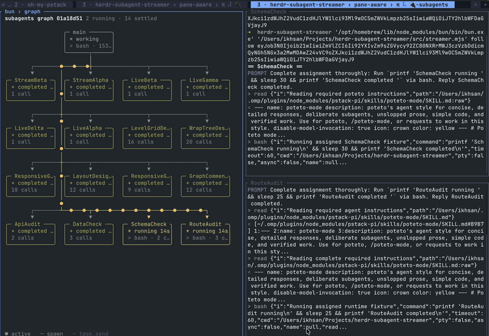

# herdr-subagent-streamer



Watch subagents work live in **Herdr or tmux**. Each active subagent streams its prompts, thinking, tool calls, and results into a reusable transcript pane, next to a live graph of the whole session. Works with OMP, omo native, and opencode. Outside Herdr and tmux the plugin does nothing, so it is safe to install everywhere.

The streamer opens a tab named `<main agent's tab>-subagents` without taking focus, and closes it 5 seconds after every subagent finishes. If the agent exits first, the tab stays until its omo subagents finish, or closes right away with OMP, whose subagents die with it.

## Stream modes

| Mode | Panes |
|---|---|
| `hybrid` (default) | The graph, plus a transcript pane for each active worker. |
| `tail` | A status board, plus the same transcript panes. |
| `graph` | The graph only. |

`GLOSSARY.md` draws each layout. Only workers that are `started` or `running` get a transcript pane. A finished worker's pane keeps its output until another worker needs it, and the pane count grows only to the peak number of active workers. The graph keeps every known subagent in view, including finished ones, and draws `task_send` messages between subagents.

## Install

Requirements: Herdr (`herdr` on PATH) or tmux, plus `bun` or `node` >= 18. No npm dependencies. Native Windows Herdr panes assume PowerShell.

### OMP

```bash
omp plugin install 'github:pararang/herdr-subagent-streamer'
```

Restart OMP. `/reload-plugins` alone is not enough, because the plugin loads an extension module.

### omo native

```bash
omo install git:github.com/pararang/herdr-subagent-streamer
```

`omo install -l` installs for one project. omo loads project-local packages only after you approve them, so start with `omo --approve`.

### opencode

Clone the repository, then link the plugin:

```bash
git clone https://github.com/pararang/herdr-subagent-streamer
ln -s "$PWD/herdr-subagent-streamer/opencode-plugin/herdr-subagent-streamer.js" ~/.config/opencode/plugins/
```

opencode keeps subagents as child sessions in `~/.local/share/opencode/opencode.db`. The plugin starts a watcher that launches the streamer on the pane's first subagent. It needs Herdr, macOS or Linux, and `bun` or a node with `node:sqlite` (node >= 22.13). Without `node:sqlite`, it needs the `sqlite3` CLI.

To start the streamer by hand, run `bin/streamer-here.sh` for this pane now, or `bin/streamer-here.sh --watch` to wait for the first subagent. A manual run streams until you kill the pid it prints. Set `STREAMER_SESSION=<id>` when Herdr does not register a session, as with `opencode run`.

### Install a specific version

Releases are Git tags named `v<version>`. List them on the [Releases page](https://github.com/pararang/herdr-subagent-streamer/releases). The opencode host exists from `v0.2.0` onward.

- **OMP.** Add the tag to the source, then restart OMP: `omp plugin install 'github:pararang/herdr-subagent-streamer#v0.2.0'`.
- **omo native and opencode.** Clone the tag with `git clone --branch v0.2.0 https://github.com/pararang/herdr-subagent-streamer`, then install from the checkout (`omo install ./herdr-subagent-streamer`, or the opencode link above). Switch versions with `git checkout <tag>` in the clone.
- **Release archive.** Extract the release's `.tgz`, then run `omp plugin install ./package` or `omo install ./package`.

After you switch versions, restart each running agent session. A streamer that is already running keeps its loaded code until it restarts.

Registering with the Herdr marketplace (`herdr plugin install pararang/herdr-subagent-streamer`) only adds discovery metadata. It does not enable streaming or select a version.

## Configuration

Set the stream mode in `~/.config/herdr-subagent-streamer/config.json`, or under `$XDG_CONFIG_HOME`:

```json
{ "streamMode": "tail" }
```

The config is read when the streamer starts, so a change applies to the next agent session. An unknown value logs a warning and falls back to `hybrid`.

| Variable | Default | Meaning |
|---|---|---|
| `HERDR_SUBAGENT_STREAMER_STREAM_MODE` | config file, else `hybrid` | Overrides `streamMode`. |
| `HERDR_SUBAGENT_STREAMER_CLOSE_MS` | `5000` | Close the tab this long after all subagents settle. `0` keeps it open. |
| `HERDR_SUBAGENT_STREAMER_HOST` | `omo` when `OMO_NATIVE=1`, else `omp` | Force the host adapter. |
| `HERDR_SUBAGENT_STREAMER_MUX` | `herdr` when `HERDR_ENV=1`, else `tmux` when `$TMUX` is set | Force the multiplexer. |

The streamer's log is `<tmpdir>/herdr-subagent-streamer/<pane>.log`.

## Limits

- Hosts are polled about once a second. A task that finishes between polls without being seen as active gets no transcript pane. It can still appear in the graph or board.
- Queued tasks and tasks already finished when discovered get no transcript pane. OMP queued tasks are not discovered at all, because the streamer sees only the lifecycle feed.
- OMP emits `started` events only for detached background spawns. A blocking spawn first appears after it finishes.
- omo keeps `status: running` for a detached subagent whose parent exited. The streamer treats such a transcript as finished once it ends in a plain assistant reply and has been quiet for 3 seconds.
- Transcript panes are tails, not Herdr agents. They have no working or idle badge, and you cannot type into them.
- A graph taller than its pane is cut off at the bottom. There is no scrolling yet.
- The streamer reads each host's on-disk layout and event payloads, which are not stable public APIs. If a host update breaks it, check `src/hosts.mjs` first.

Tested with omo native 5.1.33, OMP 18.10.4 and 18.14.1, Herdr 0.9.5, and tmux 3.8.

## Develop

```bash
npm test
```

| Module | Owns |
|---|---|
| `src/session.mjs` | The tab, slot assignment and reuse, and closing once subagents settle. |
| `src/follower.mjs` | The transcript pane process, and the receipt file that tells the session a pane is free. |
| `src/mux.mjs` | The Herdr and tmux commands. |
| `src/hosts.mjs`, `src/opencode.mjs` | Where each host keeps subagent records and transcripts. |
| `src/transcript.mjs` | Reading transcript JSONL incrementally. |
| `src/graph.mjs` | The graph's model, layout, and drawing. |
| `src/launch.mjs`, `src/here.mjs` | Starting one streamer per pane. |
| `extension/index.js`, `opencode-plugin/` | The agent-side entry points that start the streamer. |

`GLOSSARY.md` defines the terms these modules use, such as worker, slot, and settled.

`test/streamer.test.mjs` drives the real `auto` CLI against recording Herdr and tmux executables, without a real Herdr server or tmux session. `test/session.test.mjs` runs the session against an in-memory multiplexer and fake followers, so slot reuse, revival, and close timing are checked in milliseconds.

## Release

1. Set `version` to the same value in `package.json` and `herdr-plugin.toml`.
2. Run `npm run release:check -- v<version>` and `npm test`.
3. Commit, then tag and push: `git tag -a v<version> -m "Release v<version>" && git push origin v<version>`.

Pushing the tag starts `.github/workflows/release.yml`. It validates both versions, runs the tests, packs the checkout with `npm pack`, and creates a GitHub Release with the `.tgz` attached. A tag with a prerelease suffix, such as `v0.3.0-rc.1`, creates a prerelease. The workflow does not publish to npm.

## License

MIT
