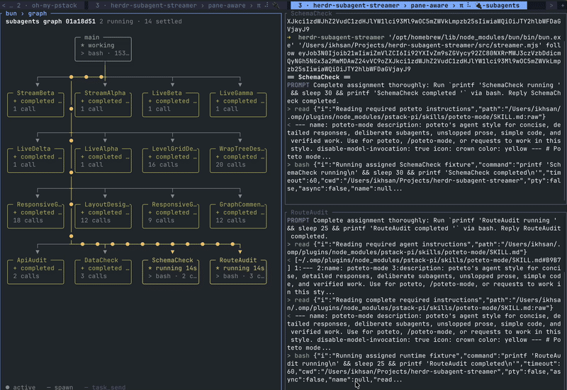

# herdr-subagent-streamer



An **OMP plugin** for watching subagents work live in **Herdr or tmux**. Prompts, thinking, tool calls, and results stream into reusable transcript panes alongside a live agent graph.

Built for an OMP + Herdr workflow, with tmux as an alternative display backend and **omo native** support through the same extension. Install the plugin once; it starts the streamer automatically for each session.

Herdr and tmux have been smoke-tested in isolated real sessions with fixture lifecycle feeds. Host integration coverage is listed under [Tested](#tested).

```
tab "1"               tab "1-subagents"
+-----------------+   +-------------------+-------------------+
| main agent      |   | board (status)    | scout   (live)    |
|                 |   |                   +-------------------+
|                 |   |                   | fixer   (live)    |
+-----------------+   +-------------------+-------------------+
```

That is the `tail` stream mode. The `graph` mode puts the whole session in one pane instead: a flow graph with a card per agent, the main agent on top, spawn edges down to each subagent (nested ones under the subagent that spawned them), and `task_send` messages between subagents drawn as magenta `├─▶` edges. Edges animate while their agent is working. Inspired by [zoetrope](https://github.com/furkankly/zoetrope).

```
 subagents graph 01a18b81 1 running · 1 settled

 ╭─ main ─────────────────╮
 │ ~ waiting              │
 │ 2 calls                │
 ╰────────────┬───────────╯
              ●
              ├──●───●───●───●───●───●───●┐
              ▼                           ▼
 ╭─ alpha ────────────────╮  ╭─ beta ─────────────────╮
 │ + completed 14s        │  │ * running 30s          │
 │ 4 calls · 1 msg        │  │ > eval · 2 calls       │
 ╰────────────────────────╯  ╰────────────────────────╯

 ● active   ─ spawn   ─ task_send
```

The default `hybrid` mode combines the two. The graph is the tab's first pane, with live transcript panes next to it. The graph keeps known subagents in view after they finish, while transcript panes follow active workers.

```
tab "1-subagents" (hybrid)
+-------------------+-------------------+
| graph             | scout   (live)    |
|                   +-------------------+
|                   | fixer   (live)    |
+-------------------+-------------------+
```

- Tab name: `<main agent's tab name>-subagents`, read at runtime.
- Transcript panes belong only to workers observed as `started` or `running`. Queued, pending, unknown, and terminal-only workers do not get transcript panes.
- A finished worker's pane can retain its final output until another worker needs it. The next active worker reuses that physical pane with a new title and cleared output. The graph or status board stays separate.
- The transcript pane count grows only to the peak number of active workers observed in that tab. Three active workers and two queued workers use three transcript panes, not five. The streamer does not change the host's concurrency setting.
- Closes itself 5 seconds after every subagent in it has finished. If the agent exits first, the tab stays until its subagents finish (omo) or closes right away (omp, whose subagents die with it).
- Outside herdr/tmux the plugin does nothing, so it is safe to install everywhere.

## Install

Requirements: Herdr (`herdr` on PATH) or tmux, plus `bun` or `node` >= 18 on PATH. No npm dependencies.

### OMP (recommended)

Install directly from GitHub—no Herdr plugin registration or marketplace catalog is required:

```bash
omp plugin install 'github:pararang/herdr-subagent-streamer'
```

Restart OMP after installing, then start a session inside Herdr or tmux and spawn subagents as usual. This plugin loads an extension module, so `/reload-plugins` alone is not enough.

To pin a release, append its published tag to the source, for example `'github:pararang/herdr-subagent-streamer#v0.1.0'` once that tag exists. To upgrade a Git installation, run `omp plugin install` again with the source and tag you want, then restart OMP.

For local development:

```bash
git clone https://github.com/pararang/herdr-subagent-streamer
omp plugin install ./herdr-subagent-streamer
# Or load the extension for one run:
omp -e ./herdr-subagent-streamer/extension/index.js
```

The local install links the checkout. See [OMP's plugin documentation](https://omp.sh/docs/plugins) for plugin management.

### omo native

```bash
omo install git:github.com/pararang/herdr-subagent-streamer
# Or from a checkout:
omo install ./herdr-subagent-streamer
```

`omo install -l` (project-local) works too, but omo only loads project-local packages after you approve them: start with `omo --approve`.

### Optional Herdr marketplace registration

The [Herdr marketplace](https://herdr.dev/plugins/) discovers this repository through its `herdr-plugin` GitHub topic and root `herdr-plugin.toml`.

```bash
herdr plugin install pararang/herdr-subagent-streamer
# Update an existing registration:
herdr plugin update pararang.subagent-streamer
```

This is optional discovery metadata, not the streaming installation. It does not load the agent extension or start the streamer. Install the OMP plugin or omo extension above to enable streaming. The Herdr manifest has no build commands, startup hooks, actions, or panes; tmux users do not need it.

## Use

Start OMP in a Herdr or tmux pane and spawn subagents as usual. Known subagents open the `-subagents` overview tab without requesting focus. In `hybrid` or `tail` mode, active workers receive reusable transcript panes. In `graph` mode, the tab has only the graph. The same behavior is available when running omo native.

For installations symlinked to this checkout, restart each running agent session after an update. Each linked profile uses the same source files, but an existing detached streamer keeps its loaded code until it restarts.

## How it works

The extension (`extension/index.js`) runs when a session starts and launches `src/streamer.mjs` as a detached process for that session, then stops it on shutdown. The streamer finds subagents through a host adapter (`src/hosts.mjs`):

| Host | Where subagent state comes from |
|---|---|
| omo native | Polls `$OMO_CODING_AGENT_DIR/projects/*/senpi-task/tasks/*.json` (default `~/.omo/agent`) and tails each child's transcript under `children/<id>/sessions/<id>/`. |
| omp | The extension forwards the `task:subagent:lifecycle` event (`id`, `status`, `sessionFile`) to a feed file in the temp dir; the transcript is the event's `sessionFile`, or `<session file minus .jsonl>/<id>.jsonl`. |

In `hybrid` and `tail` mode, the streamer assigns active workers to transcript slots. Each slot owns a physical pane and runs a follower until its worker settles. Before reusing the pane, the streamer waits for the follower to drain the available complete transcript records, flush its output, and exit. The next assignment clears the old viewport and scrollback before showing the new worker's title and transcript. A worker that becomes active again can receive a slot again, including after the tab closes. Its transcript can replay on revival.

The first pane is the graph in `hybrid` mode and the status board in `tail` mode. Both retain the host's full list of known subagents independently of transcript slot ownership. In `graph` mode, the tab has only the graph pane (`streamer.mjs graph`). The graph reads every available transcript incrementally. The task record's `parent_session_id` places each subagent under the agent that spawned it in omo. OMP subagents all hang off the main agent. Tool calls fill the cards, and `task_send` calls become message edges. A follow-up message to an agent's own child is counted on the child's card instead of getting a second edge.

The streamer drives Herdr with `tab create`, `pane split`, `pane run`, and `tab close`. For tmux, it creates idle transcript panes with pane-local `remain-on-exit`, then uses `respawn-pane` to start each follower after the previous assignment exits.

## Configuration

`~/.config/herdr-subagent-streamer/config.json` (or under `$XDG_CONFIG_HOME`):

```json
{ "streamMode": "tail" }
```

| Key | Values | Default | Meaning |
|---|---|---|---|
| `streamMode` | `hybrid`, `tail`, `graph` | `hybrid` | `hybrid` has a graph plus reusable active-worker transcript panes. `tail` has a status board plus the same transcript panes. `graph` has only the graph pane. An unknown value logs a warning and falls back to `hybrid`. |

The config is read when the streamer starts, so a change applies to the next agent session.

| Variable | Default | Meaning |
|---|---|---|
| `HERDR_SUBAGENT_STREAMER_STREAM_MODE` | config file, else `hybrid` | Overrides `streamMode`. An unknown value falls back to `hybrid`. |
| `HERDR_SUBAGENT_STREAMER_CLOSE_MS` | `5000` | Close the tab this long after all subagents settle. `0` keeps it open. |
| `HERDR_SUBAGENT_STREAMER_HOST` | `omo` when `OMO_NATIVE=1`, else `omp` | Force the host adapter. |
| `HERDR_SUBAGENT_STREAMER_MUX` | `herdr` when `HERDR_ENV=1`, else `tmux` when `$TMUX` is set | Force the multiplexer. |

The streamer's log is `<tmpdir>/herdr-subagent-streamer/<pane>.log`.

## Limits

- Hosts are polled about once a second. A short task that finishes between polls and is never observed as active gets no transcript pane. It can still appear in the graph or status board if the host reports it.
- OMP emits `started` events only for detached background spawns. A blocking spawn first appears after it has finished, so it gets no transcript pane.
- omo only: a detached subagent whose parent already exited keeps `status: running` in omo's record. The streamer treats a transcript that ends in a plain assistant reply and has been quiet for 3 seconds as finished.
- Tasks that are already terminal when discovered get no transcript pane. Queued tasks remain in the graph or status board only if the host exposes them. The streamer does not discover queued OMP tasks beyond the lifecycle feed.
- The splits are transcript tails, not herdr agents: no working/idle badge and no typing into them.
- A large number of simultaneously active workers makes small transcript panes. Completed workers do not add panes. The graph adapts to its own pane width and wraps whole subtrees onto additional rows. Resizing the pane reflows the cards. Extremely narrow panes shorten card text. Graphs taller than the pane are still cut off at the bottom, with no scrolling yet.
- It reads each host's on-disk layout and event payloads, which are not stable public APIs. If a host update breaks it, check `src/hosts.mjs` first.

## Tested

- omo native 5.1.33: installed with `omo install -l --approve`; a real session spawned two subagents, the tab opened with a board plus two live splits, and it closed itself after they finished.
- omp 18.10.4: installed with `omp plugin install`; the extension loads, `session_start` fires, a `task:subagent:lifecycle` event emitted on omp's event bus reaches the feed, and the tab opens and closes.
- OMP 18.14.1: isolated local installs from the checkout and an extracted `npm pack` archive both appear as enabled plugins with the extension entry point in `omp plugin list --json`. GitHub install syntax was checked with `--dry-run`; this check did not fetch the remote repository or start an agent session.
- Live OMP session in herdr: four concurrent subagents streamed into separate panes, completed, and triggered automatic tab closure. The graph renderer showed all six fixture agents at 73 and 43 columns in a real herdr pane and reflowed after resizing. The streaming tab took focus when it opened, contrary to the intended no-focus behavior.
- Herdr 0.9.5 and tmux 3.8: isolated real sessions with OMP-shaped lifecycle feeds verified three active transcript panes, queued-worker exclusion, same-pane A-to-D and B-to-E handoffs, and cleared replacement output. Herdr also verified revival, graph-only history, and automatic closure. tmux verified operation with a retained Herdr environment, `default-command=true`, and reopening after a manual window close.

## Develop

```bash
npm test        # node --test
```

`test/streamer.test.mjs` drives the actual `auto` CLI with isolated lifecycle feeds and recording Herdr and tmux executables. The executables launch real follower commands and capture pane titles, rendered output, command exits, and tab lifecycle events. These tests do not connect to a real Herdr server or tmux session.

## Release

Releases use Git tags named `v<version>`, such as `v0.1.0` or
`v0.2.0-rc.1`. The version must match both `package.json` and
`herdr-plugin.toml`. Prerelease identifiers follow SemVer; build metadata
(`+...`) is not supported in release tags.

From the branch you intend to release:

1. Update `version` in both files to the same value.
2. Run the checks locally:

   ```bash
   npm run release:check -- v0.1.0
   npm test
   npm pack --dry-run
   ```

3. Commit the version changes and push that commit.
4. Tag that commit and push the tag:

   ```bash
   git tag -a v0.1.0 -m "Release v0.1.0"
   git push origin v0.1.0
   ```

Replace `0.1.0` with the version being released. Pushing the tag starts
`.github/workflows/release.yml`, which validates both versions, runs the
tests, and packages the tagged checkout with `npm pack`. Only after those
steps succeed does it create a GitHub Release with generated release notes
and a `herdr-subagent-streamer-<version>.tgz` attachment. Tags with a
prerelease suffix create GitHub prereleases and do not become the latest
release. The workflow uses the repository's `GITHUB_TOKEN` with
`contents: write`; no additional publishing secret is needed.

The workflow does not publish to npm. Existing Git and checkout installs
remain available. To install a release archive, download its `.tgz` from
[GitHub Releases](https://github.com/pararang/herdr-subagent-streamer/releases),
extract it, then run `omp plugin install ./package` (or
`omo install ./package` for omo native) from the extraction directory.

## License

MIT
